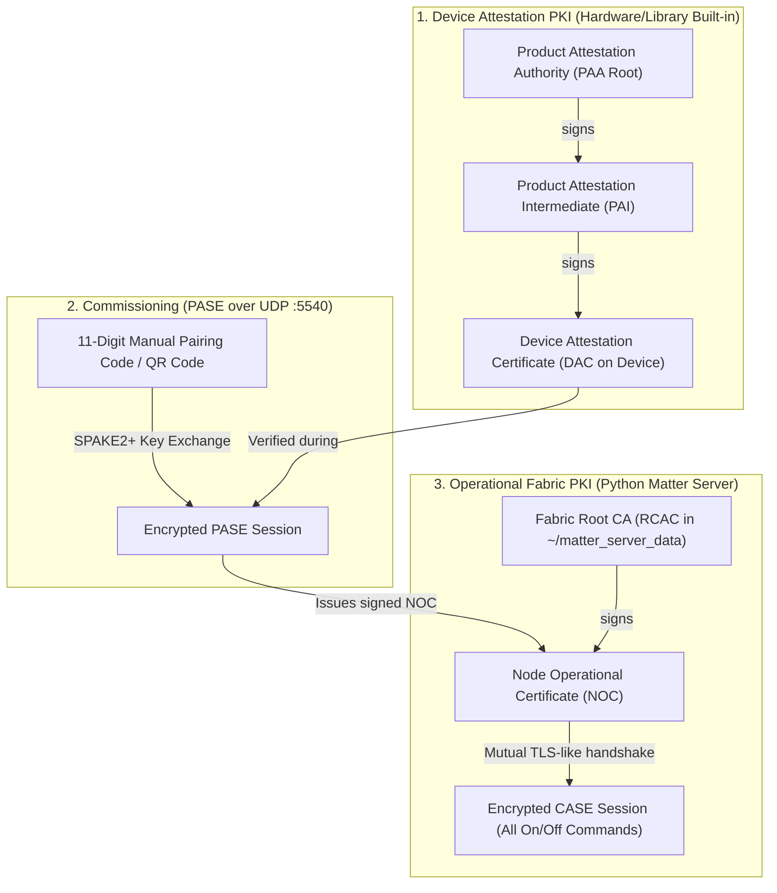

# Matter Commissioning, Security & Networking Guide

This guide continues from the [Home Assistant & Matter Server Setup Guide](./HA%20Matter%20Setup.md). While protocols like MQTT start unencrypted and unauthenticated until you manually build an OpenSSL CA, password files, and ACLs, **Matter enforces mutual cryptographic authentication and encryption by specification**. Every device must be commissioned into a cryptographic **Fabric** before any command can be sent.

This guide covers four key topics:

1. **[How Matter Security Works](#1-how-matter-security-works)**: PASE commissioning, Device Attestation (DAC), Fabric CA, and CASE operational encryption.
2. **[Commissioning Methods & Multi-Admin](#2-commissioning-methods--multi-admin)**: On-network pairing codes vs. BLE, and sharing a single device across Home Assistant, Apple Home, and Google Home.
3. **[Managing State & Factory Resetting](#3-managing-state--factory-resetting)**: Inspecting, backing up, and resetting `matter-device-state.json` and Matter Server fabrics.
4. **[IPv6, mDNS & Container Networking Troubleshooting](#4-ipv6-mdns--container-networking-troubleshooting)**: Ensuring reliable discovery on the Arduino Q.

## 1. How Matter Security Works

In Matter, you never configure static usernames, passwords, or shared broker certificates. Instead, Matter combines two distinct Public Key Infrastructures (PKIs) and two cryptographic session protocols:



### The Four Security Layers

| Layer | What It Does | Equivalent in Secured MQTT |
| :--- | :--- | :--- |
| **PASE** *(Password-Authenticated Session Establishment)* | Uses the 11-digit Pairing Code and the **SPAKE2+** zero-knowledge proof protocol to bootstrap an encrypted commissioning channel without ever transmitting the passcode over the network. | Initial password provisioning |
| **Device Attestation** *(PAA $\rightarrow$ PAI $\rightarrow$ DAC)* | Proves the device is genuine hardware (or an approved test device using test Vendor ID `0xFFF1`–`0xFFF4`) before the controller joins it to your home. | Server/Client identity check |
| **Fabric & NOC** *(Node Operational Certificate)* | During commissioning, your Python Matter Server acts as a local **Certificate Authority (CA)** and issues a unique **Node Operational Certificate (NOC)** and 64-bit Node ID to the device. | Mutual TLS (`client.crt` + `ca.crt`) |
| **CASE** *(Certificate-Authenticated Session Establishment)* | Every subsequent command (such as toggling the Arduino Q LED matrix ON or OFF) is mutually authenticated and AES-CCM encrypted using the device's NOC. | TLS 1.3 + Per-client ACLs |

### Sensitive Files & Where They Live

| File / Directory | Secret? | Location & Purpose |
| :--- | :--- | :--- |
| `matter-device-state.json` | 🔴 **Yes** | Project root (git-ignored). Generated automatically by `circuitmatter` on first run. Stores the device's DAC private key, SPAKE2+ verifier, operational private keys, NOCs, and persisted cluster attributes. |
| `~/matter_server_data/` | 🔴 **Yes** | Host directory mounted into `matter-server` at `/data`. Contains your Home Assistant Matter Fabric Root CA key and commissioned node database. Back this up with your Home Assistant config. |
| `.env` | 🟢 No | Optional device name (`DEVICE_NAME`), endpoint label (`ENDPOINT_NAME`), and Vendor/Product IDs. Contains no secrets. |

> [!CAUTION]
> Never commit `matter-device-state.json` to git. Anyone with this file possesses the operational private key for that Matter node in your fabric. `.gitignore` excludes `matter-device-state.json` by default.

## 2. Commissioning Methods & Multi-Admin

### Method A: On-Network Commissioning (Recommended for Arduino Q & LAN Devices)

Because both the Arduino Q Python app (`circuitmatter`) and the [Example ESP32 Matter (Milieu Panel)](https://github.com/rcpeters/Milieu-Panel) are already connected to your local network (Ethernet or Wi-Fi), they immediately advertise a commissionable Matter service over **mDNS** (`_matterc._udp.local`).

You can pair them directly from any desktop browser without needing Bluetooth or a mobile app:

1. Open the Python Matter Server UI at `http://<BOARD_IP>:5580`.
2. Click **Commission node**.
3. Enter the **11-digit Manual Pairing Code** printed in the console output.

Alternatively, in Home Assistant:
1. Open **Developer Tools > Actions**.
2. Choose **Matter: Commission a device (`matter.commission`)**.
3. Paste the **11-digit Manual Pairing Code** into the **Code** field and click **Perform Action**.

### Method B: BLE + Mobile Companion App Commissioning

For commercial off-the-shelf Matter devices (which do not know your Wi-Fi credentials out of the box):
1. Open the **Home Assistant Companion App** on your iOS or Android phone.
2. Go to **Settings > Devices & Services > Matter > Add Device**.
3. Scan the Matter **QR Code**. Your phone uses Bluetooth Low Energy (BLE) to send your Wi-Fi credentials to the device, and then hands off operational commissioning to the `matter-server` running on your Arduino Q.

### Multi-Admin: Using One Device in Multiple Ecosystems Simultaneously

One of Matter's biggest advantages over custom MQTT setups is **Multi-Admin**. Because a single Matter node can hold multiple **Node Operational Certificates (NOCs)**—one per ecosystem fabric—you can control the Arduino Q LED Matrix from **Home Assistant**, **Apple Home**, and **Google Home** at the same time:

1. In Home Assistant, open **Settings > Devices & Services > Matter** and select your **Arduino Q** device.
2. Click **Share Device**.
3. Home Assistant opens a temporary commissioning window on the Arduino Q and generates a new one-time **Pairing Code / QR Code**.
4. Scan or enter that code in Apple Home or Google Home. Toggling the switch in any ecosystem now updates the 8x13 LED Matrix and syncs the state across all connected controllers!

## 3. Managing State & Factory Resetting

When `python/main.py` starts for the first time, `circuitmatter` generates `matter-device-state.json` and prints the device's onboarding payload:

```text
Initializing Matter device 'Arduino Q' (VID=0xFFF4, PID=0x1234)...
Persistent state file: /home/arduino/ArduinoApps/Home-Assistant-Arduino-Matter-Example/matter-device-state.json
Manual code: 34970112332
...
Matter device is NOT commissioned yet. Displaying '?' on LED matrix.
```

### Common Maintenance Tasks

| Task | How to Perform It |
| :--- | :--- |
| **Inspect commissioning state** | Check if `matter-device-state.json` contains a non-empty `"fabrics"` list under Endpoint `0` / Cluster `62` (`0x003E` Operational Credentials). |
| **Remove device cleanly** | In Home Assistant, go to **Settings > Devices & Services > Matter**, select the device, open the **⋮** menu, and click **Delete**. The Arduino Q detects that all fabrics were removed and automatically restores the `?` icon on the LED matrix. |
| **Factory reset the Arduino Q Matter node** | Stop the app, delete `matter-device-state.json` (`rm matter-device-state.json`), and restart the app. A fresh state file and pairing code will be generated, and the LED matrix will show `?`. |
| **Factory reset the ESP32 Matter node** | Hold the `BOOT` button (`GPIO 0`) on the ESP32 for **5 seconds** until the Serial Monitor prints `Decommissioning Matter node (factory reset)...`. |

## 4. IPv6, mDNS & Container Networking Troubleshooting

Unlike MQTT—which uses a single outbound TCP connection to a known IPv4 address and port—Matter relies on **multicast mDNS discovery (`UDP 5353`)** and **IPv6 UDP (`UDP 5540`)**. If commissioning fails or times out during discovery, check these four requirements:

### 1. Host `avahi-daemon` vs. App Lab Container mDNS

There are two separate containers involved on the Arduino Q:

1. **The `matter-server` Container (You control via Docker / Docker Compose)**:
   - Runs with `--network=host` and mounts both `/run/dbus:/run/dbus:ro` and `/var/run/avahi-daemon/socket:/var/run/avahi-daemon/socket` so the Matter controller can talk directly to the host's `avahi-daemon`.
   - Ensure `avahi-daemon` is installed and running on the Arduino Q host:
     ```bash
     sudo apt-get update && sudo apt-get install -y avahi-daemon avahi-utils
     sudo systemctl enable --now avahi-daemon
     ```
   - **Recommended (mDNS Reflection Across the Docker Bridge)**: Because the Arduino App Lab container runs on an internal Docker bridge (`172.24.0.x`), enabling Avahi's reflector in `/etc/avahi/avahi-daemon.conf` on the host ensures mDNS announcements from the App Lab bridge are reflected across all host interfaces:
     ```bash
     sudo sed -i 's/^#*enable-reflector=.*/enable-reflector=yes/' /etc/avahi/avahi-daemon.conf
     sudo systemctl restart avahi-daemon
     ```

2. **The Arduino App Lab Container (`/app`, managed by `arduino-app-cli`)**:
   - Because `arduino-app-cli` manages the `/app` container's `docker run` arguments internally (and any `apt install` inside `/app` is wiped when the container is rebuilt), `python/main.py` does **not** rely on `avahi-publish-service`.
   - Instead, `python/main.py` uses `zeroconf` + `_PurePythonMDNS` (installed automatically via `python/requirements.txt`) to broadcast `_matterc._udp.local.` and its discriminator subtypes (`_L...`, `_S...`) directly over UDP port `5353` from inside the container.

### 2. Verify mDNS Advertisement on the Board

While the Arduino Q Matter app is running, you can confirm that its Matter records are visible on the network using `avahi-browse`:

```bash
# Before commissioning (look for _matterc._udp):
avahi-browse -rt _matterc._udp

# After commissioning (look for _matter._tcp):
avahi-browse -rt _matter._tcp
```

### 3. Verify Host Networking & D-Bus Mount on `matter-server`

The `matter-server` container must share the host's network namespace (`--network=host`) and have read-only access to `/run/dbus:/run/dbus:ro` so it can query the host's Avahi daemon and reach IPv6 link-local addresses (`fe80::...`):

```bash
docker inspect matter-server --format '{{.HostConfig.NetworkMode}}'
# Expected output: host
```

### 4. Test Attestation Certificates (Test Vendor IDs `0xFFF1`–`0xFFF4`)

Both `circuitmatter` (Vendor ID `0xFFF4` / `65524`) and the Espressif Arduino Matter library (Vendor ID `0xFFF1`) use official **CSA Test Device Attestation Certificates (DACs)** so makers can build prototypes without paying for commercial CSA certification.

The `--paa-root-cert-dir /data/credentials` flag in [HA Matter Setup.md](./HA%20Matter%20Setup.md#3-launch-containers-via-docker) instructs `python-matter-server` to trust the official CSA Test PAA certificates alongside production certificates.

## Example ESP32 Matter Client

To connect a standalone ESP32 board to your Home Assistant Matter Server over Wi-Fi with zero-phone on-network commissioning, NVS persistence, and local button sync, see the ready-to-use example sketch and guide:

👉 **[Example ESP32 Matter (Milieu Panel)](https://github.com/rcpeters/Milieu-Panel)**
